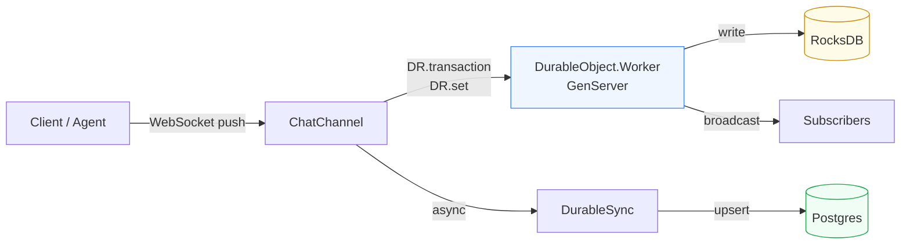
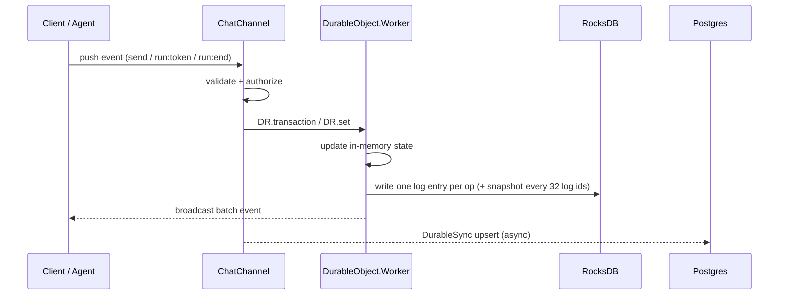
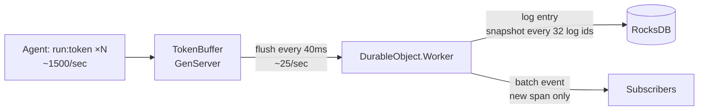
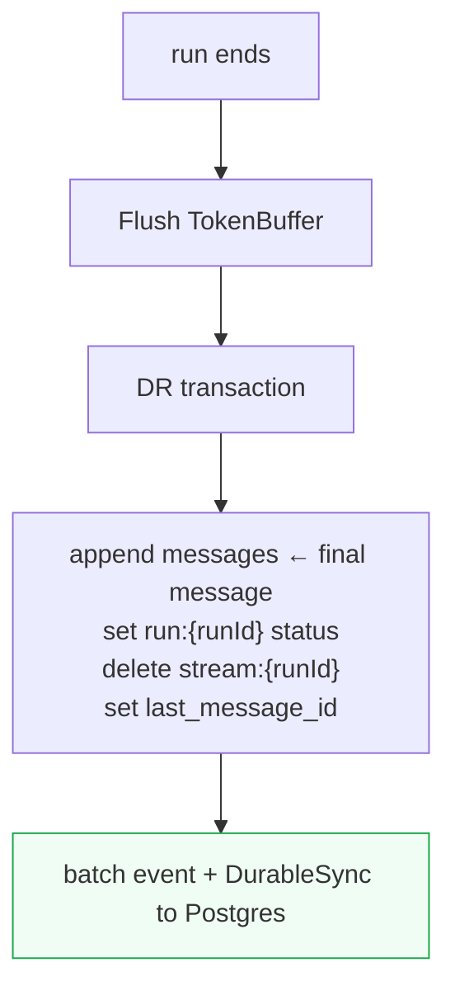
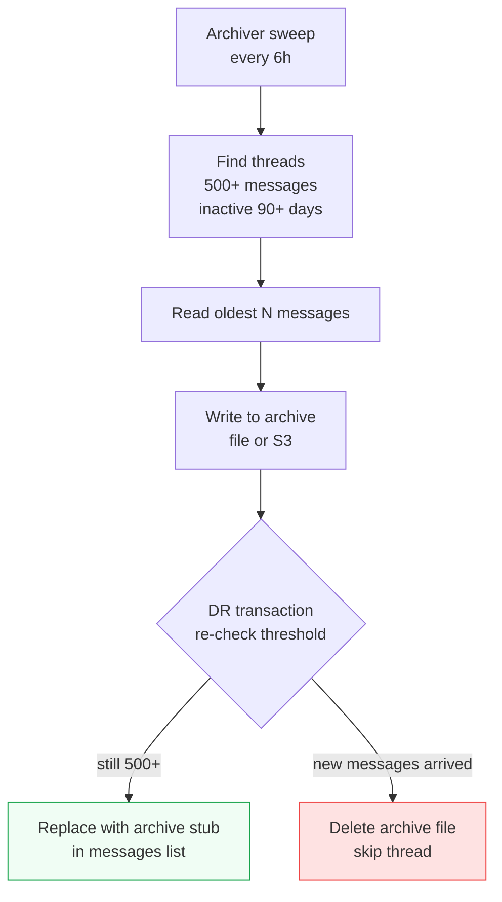
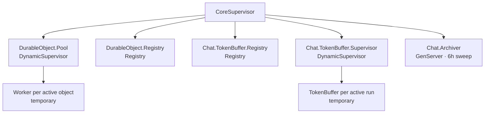

# Architecture

## Storage layer

Chat uses a two-layer storage model:

| Layer | Role | Technology |
|---|---|---|
| **Durable Objects ring** | Real-time source of truth | RocksDB WAL + in-memory state |
| **Postgres** | Search replica, API reads | Standard relational DB |

Postgres is never the primary write target. It is updated asynchronously by `DurableSync` after the WAL write succeeds.

---

## WAL write path

---

## Token streaming

LLM agents push tokens at up to 1,500/sec per run. A rollup buffer keeps this from saturating RocksDB:

Each flush is a transaction that sets `stream:{runId}` to the text accumulated so far, and only while the run is live (a flush after the run ended writes nothing). That is one log entry holding the run's text, not the thread; the full state snapshot is rewritten only once every 32 log ids, so a 25-flush/sec run does not serialise the whole thread on every flush. Subscribers receive a `batch` whose `stream:{runId}` change carries only the new span as `append`. On crash + rehydrate, the snapshot plus the log entries after it rebuild the stream slot exactly.

---

## Run compaction

Every run ending (`run:end`, `cancel`, sweeper timeout) folds its stream into one message:

The message is written as an item-only `append` log entry — the transaction never rewrites the whole `messages` list, so its cost does not grow with the thread.

---

## Generational archival

When `load_older` hits a stub it fetches the archive transparently — the client receives a normal page.

---

## Supervision tree

`TokenBuffer` processes are `:temporary` — a crash during streaming is safe. `flush_and_stop` falls back to the last committed value from the Worker's in-memory state.
