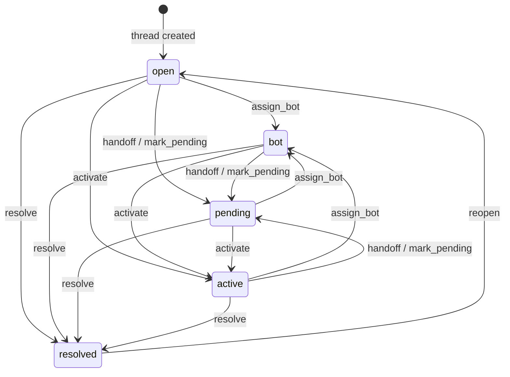
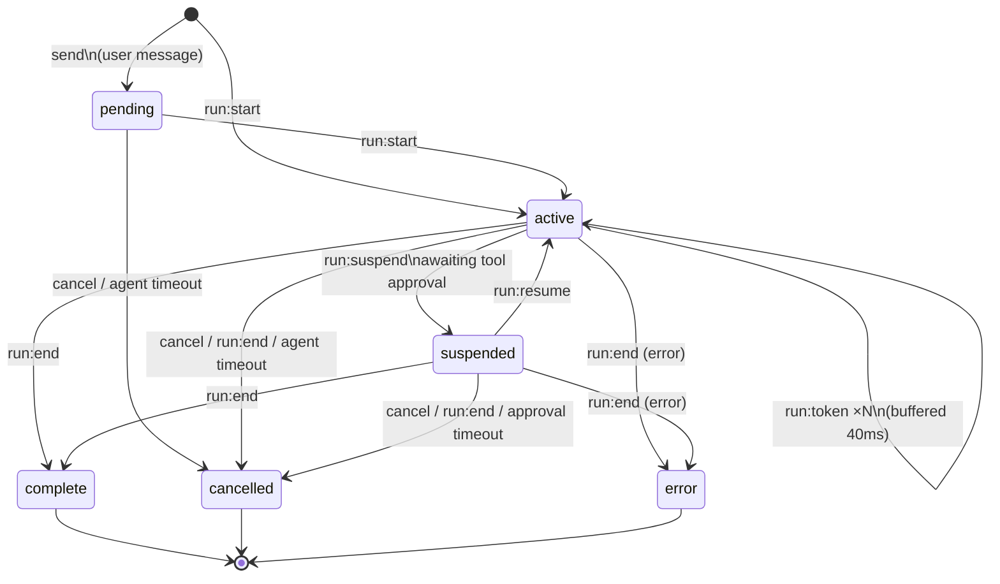
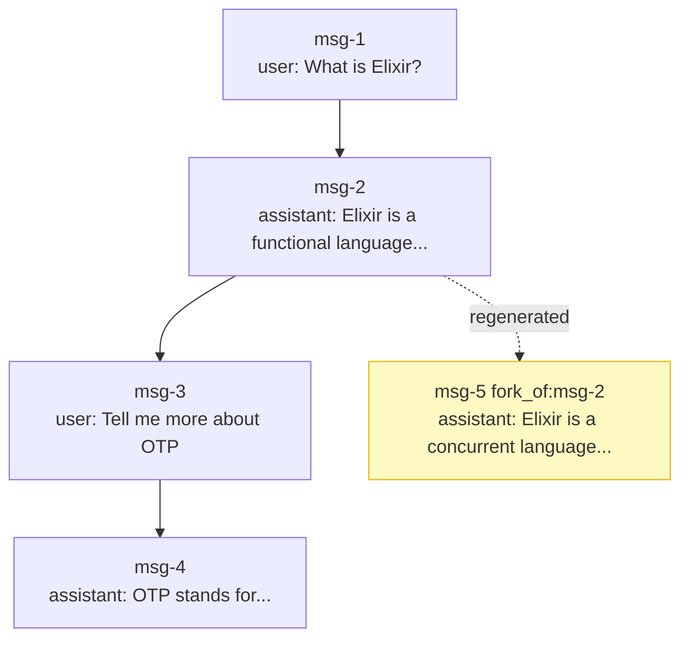
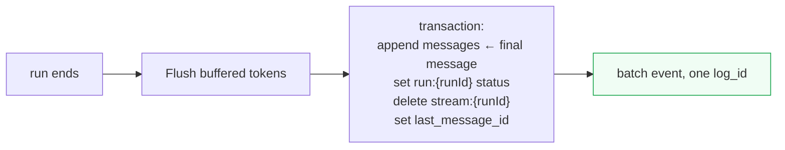
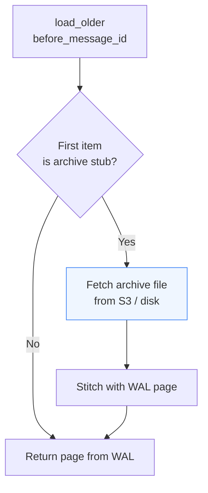

# Core Concepts

## Threads

A thread is the top-level container for a conversation.

| Field | Type | Description |
|---|---|---|
| `id` | UUID | Unique identifier |
| `app_id` | UUID | The Pingerchips app it belongs to |
| `status` | enum | `open` \| `bot` \| `pending` \| `active` \| `resolved` |
| `title` | string? | Optional display title |
| `bot_id` | UUID? | Agent assigned to this thread |
| `assigned_agent` | string? | Human agent handle (post-handoff) |
| `archived_at` | timestamp? | Set by `archive`; an archived thread takes no further changes |
| `metadata` | map | Arbitrary key-value pairs |

Thread state is stored in the Durable Objects ring and replicated to Postgres. Subscribe via:

```
chat:v1:app:{appKey}:thread:{threadId}
```

### Thread status flow

`status` and `archived_at` change only through lifecycle actions — the generic thread update does not accept them. Each action is its own REST route (`PATCH /api/chat/threads/{id}/{action}`):

| Action | Route | From | To |
|---|---|---|---|
| `assign_bot` | `/assign-bot` | `open` · `bot` · `pending` · `active` | `bot` |
| `handoff` | `/handoff` | `open` · `bot` · `pending` · `active` | `pending` |
| `mark_pending` | `/mark-pending` | `open` · `bot` · `active` | `pending` |
| `activate` | `/activate` | `open` · `bot` · `pending` · `active` (no-op) | `active` |
| `resolve` | `/resolve` | `open` · `bot` · `pending` · `active` | `resolved` |
| `reopen` | `/reopen` | `resolved` | `open` |
| `archive` | `/archive` | any status | sets `archived_at`, status kept |

Any other transition (e.g. `activate` on a resolved thread, `reopen` on an open one) is rejected with a `4xx` error. Once a thread is archived, every action — including a plain update — is rejected.



---

## Messages

| Field | Type | Description |
|---|---|---|
| `id` | UUID | Unique identifier |
| `thread_id` | UUID | Parent thread |
| `role` | string | `user` \| `assistant` \| `tool` \| `system` |
| `content` | map | `{"text": "..."}` or structured content |
| `run_id` | UUID? | The run that produced this message |
| `parent_id` | UUID? | Parent in the conversation tree |
| `fork_of` | UUID? | Original message this was regenerated from |
| `owner_client_id` | string? | Client that sent this message |
| `inserted_at` | ISO 8601 | Creation timestamp |

---

## Runs

A run is one LLM generation cycle.



A suspended run waits for a human's tool approval, so the agent timeout does not apply to it; it has its own, much longer approval timeout instead. Every ending — `run:end`, `cancel`, either timeout — takes the same path and emits the same `run:end` + `batch` events.

During streaming, token chunks are buffered in a `TokenBuffer` GenServer and flushed every 40ms into the `stream:{runId}` slot. When the run ends the final message is appended to `messages` and the stream slot is deleted.

---

## Conversation tree

Messages form a **tree**, not a list. `parent_id` links each message to the one it replies to. `fork_of` links a regenerated message to the original.



When a user regenerates, the server creates a new assistant message with `fork_of` pointing to the original. Both branches exist; the UI decides which to show.

---

## Run compaction

Every run ending folds its stream into one message, in one atomic transaction:



The message is logged as an item-only `append` entry, so a run's cost on disk does not grow with the thread's length. Subscribers receive `{ key: "messages", op: "append", item }` inside the `batch` and push `item` onto their local list.

---

## Load older / pagination

`load_older` walks backwards in pages of 50, from a `before_message_id` cursor.



Archive stubs are transparent to the client — it always receives a normal `{ messages, has_older }` page.
