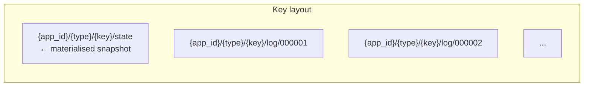
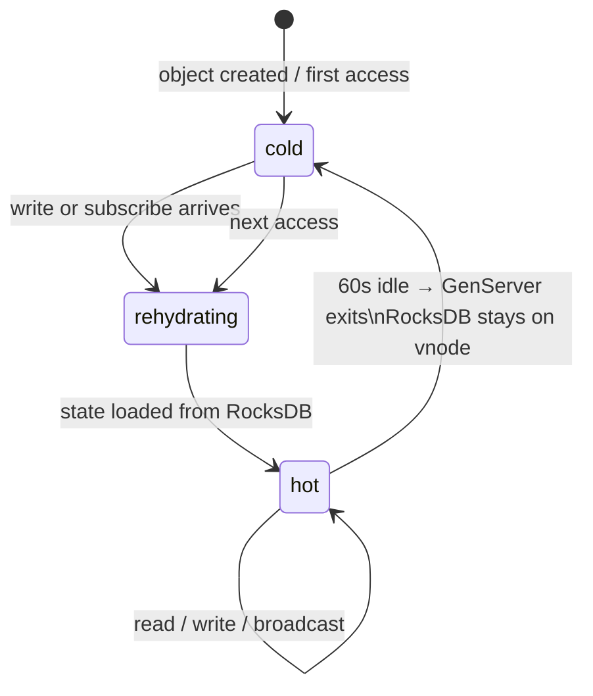
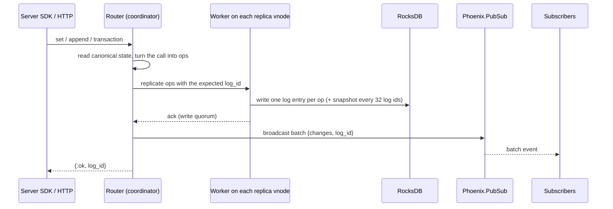
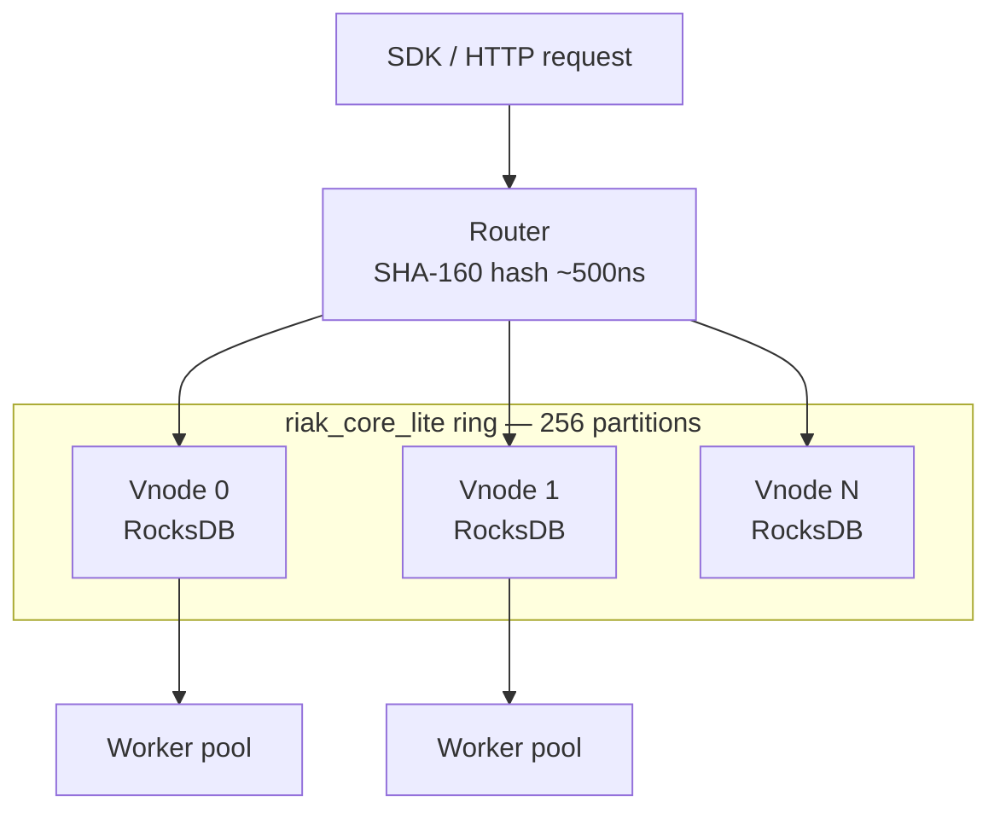
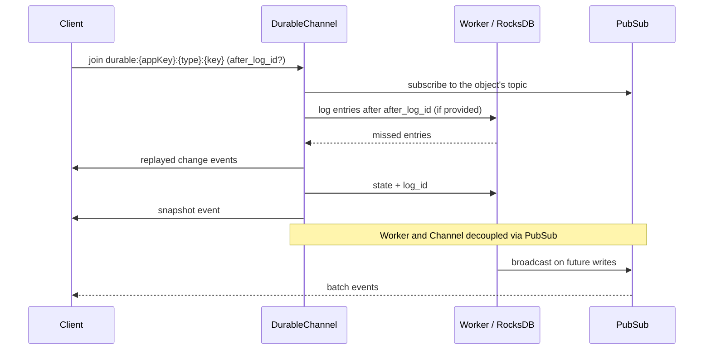
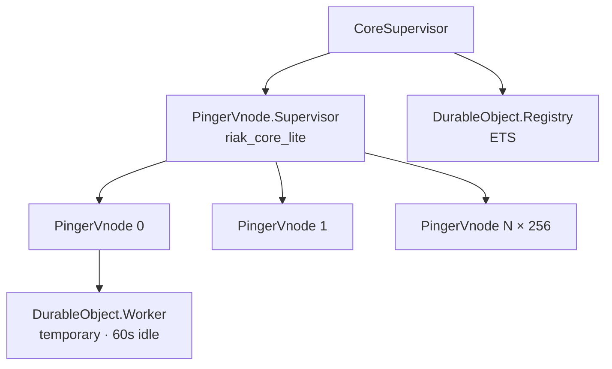

# Architecture

## Storage: RocksDB per vnode

Each object's data lives in an embedded RocksDB instance — in-process, no network hop.



All keys for one object share a prefix — rehydration is a single prefix scan, not a scatter-gather.

| Operation | Mechanism | Latency |
|---|---|---|
| Read (hot) | In-memory map | ~0 ns |
| Read (cold) | RocksDB bloom filter + memtable | ~10 µs |
| Write | Memtable + WAL append | ~50 µs |
| Rehydrate (snapshot) | Single key read | ~10 µs |
| Log replay | Sequential prefix scan | ~1 µs/entry |

---

## DurableObject Worker lifecycle



The Worker serialises all writes — no per-slot locking needed. RocksDB data persists on the vnode regardless of Worker state.

---

## Write path



---

## Log entries and snapshots

Every op is one log entry:

```
%{op: "set",    key: slot, value: term, log_id: n}
%{op: "delete", key: slot,              log_id: n}
%{op: "append", key: slot, value: item, log_id: n}   # only the appended item
```

An `append` entry holds only the new item, so appending to a long list costs O(1) on disk. The materialised state snapshot is rewritten only when a commit crosses a multiple of 32 log ids; rehydration reads the snapshot and replays the entries after it. Full-list `set` entries written by older releases still replay unchanged.

On the wire an `append` entry always appears as `{key, op: "append", item, log_id}` (`after_log_id` replay `change`, `GET /log`) and as `{key, op: "append", item}` inside a live `batch`. Clients apply it as `state[key] = [...(state[key] ?? []), item]`.

### Rolling deploys

Item-only `append` entries are written only when the `DURABLE_APPEND_OPS` flag is on **and** every ring member runs code that can replay them; otherwise appends are written as a full-list `set`. See `deploy/README.md` in the server repo for the two-release rollout and the rollback rule.

---

## Distribution: riak_core_lite ring



Routing: `partition = SHA-160(app_id <> "/" <> type <> "/" <> key) % 256` — pure arithmetic, ~500ns, no network call.

**Handoff**: when nodes join/leave, the vnode's RocksDB key range streams to the new owner. Object state migrates with the partition.

**Cold reads**: served directly by the vnode from RocksDB — no Worker started, memory proportional to active objects only.

---

## Real-time subscribe flow



---

## Supervision tree



Workers are `:temporary` — not restarted on crash. Next access rehydrates from RocksDB. A crashed Worker is equivalent to an evicted one.
