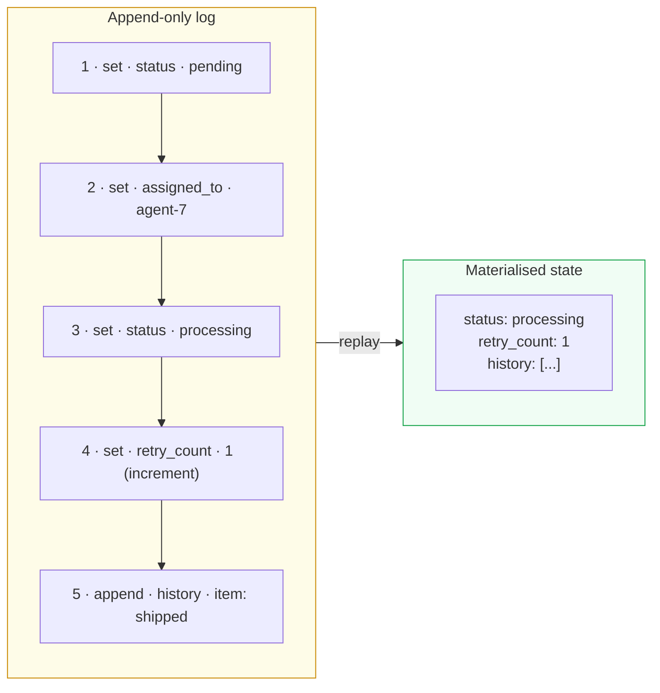
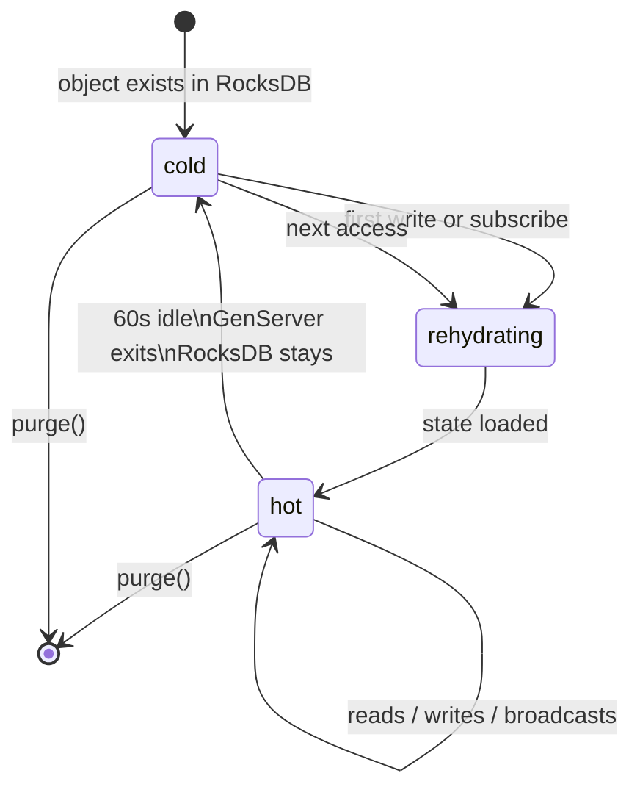
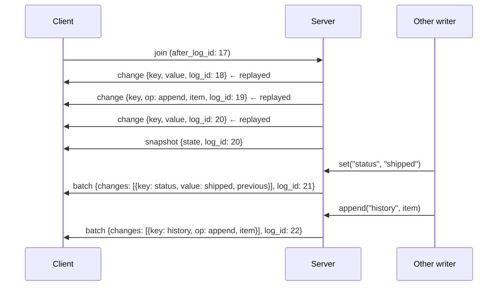
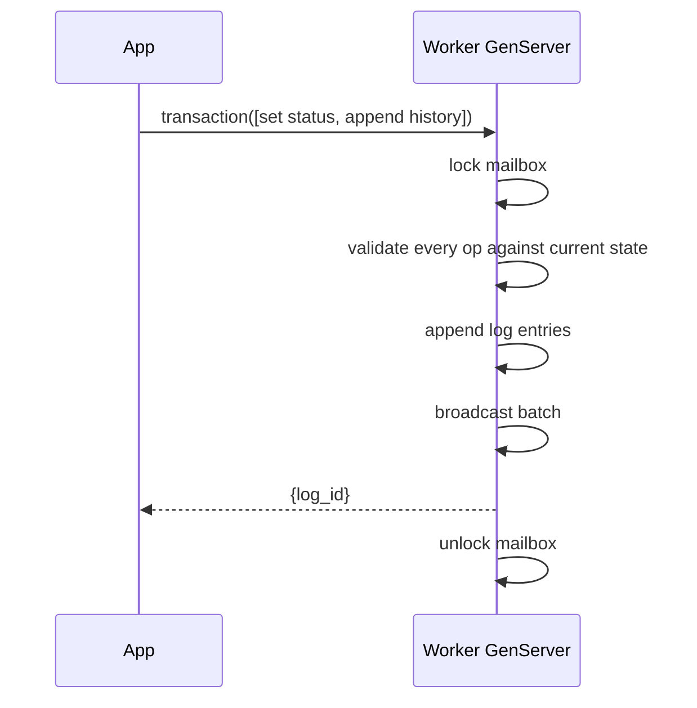

# Core Concepts

## State slots

An object's **state** is a flat map of named slots. Each slot holds any JSON-serialisable value.

```js
{
  "status":      "processing",
  "assigned_to": "agent-7",
  "retry_count": 2,
  "history":     [{ "event": "created", "at": 1718884800000 }]
}
```

Slots are created on first write and deleted explicitly. No schema required.

---

## The append-only log

Every write appends an immutable entry:



`log_id` is monotonically increasing, unique per object, returned on every write and included in every `change` / `batch` event. Each op is its own entry: `setAll` and multi-op transactions log one `set` / `delete` / `append` entry per slot with consecutive `log_id`s, and `increment` is logged as a `set` of the new value.

An `append` entry stores only the appended `item`, never the whole list, so a long list costs O(1) per append. The materialised state is snapshotted every 32 log ids; on restart state is rebuilt from the latest snapshot plus the log entries after it — no data loss possible. Clients rebuild a list the same way: `op: "append"` → `state[key] = [...(state[key] ?? []), item]`; anything else → `state[key] = value`.

---

## Operations

| Operation | Description | Returns |
|---|---|---|
| `set(slot, value)` | Set a single slot | `{ log_id }` |
| `setAll(map)` | Set multiple slots atomically | `{ log_id }` |
| `get(slot)` | Read a single slot | value (`null` if absent) |
| `increment(slot, by?)` | Atomic integer increment | `{ log_id, value }` |
| `append(slot, item)` | Append to a list slot | `{ log_id }` |
| `delete(slot)` | Remove a slot | `{ log_id }` |
| `transaction(ops)` | Apply a list of ops atomically | `{ log_id }` |
| `state()` | Read full state map | `{ state, log_id }` |
| `log(afterId)` | Read log entries after `afterId` | `{ items }` |

---

## Object lifecycle



Objects spring into existence on first write. There is no explicit create. `purge()` permanently deletes all state and log entries.

---

## Real-time subscriptions



Every subscriber receives changes in log order. `after_log_id` replays only missed entries — efficient RocksDB prefix scan, not a full scan — then the `snapshot` carries the authoritative state.

Wire shapes. Every live write, single-op ones included, arrives as one `batch`; the server sends `change` only when replaying missed entries on join. The client SDK fans each `batch` out into per-slot `change` events carrying the batch's `log_id`.

| Event | Shape |
|---|---|
| `batch` (live) | `{ changes, log_id }` — each change is `{ key, value, previous }` (`value: null` means deleted) or `{ key, op: "append", item }` (no `value` / `previous`) |
| `change` (replay only) | `{ key, value, log_id }`, or `{ key, op: "append", item, log_id }` for an append entry |

---

## Transactions

Transactions are serialised by the Worker GenServer — only one runs at a time per object.



If any op cannot apply (for example `append` to a slot that is not a list), no writes are committed.

---

## Consistency guarantees

- **Within one object**: all writes are linearised. `increment` and `transaction` are always atomic.
- **Across objects**: no cross-object transactions. Use an orchestrating process that writes sequentially.
- **Subscribers**: change events delivered in log order — a subscriber can never see `log_id` N+1 before N.
